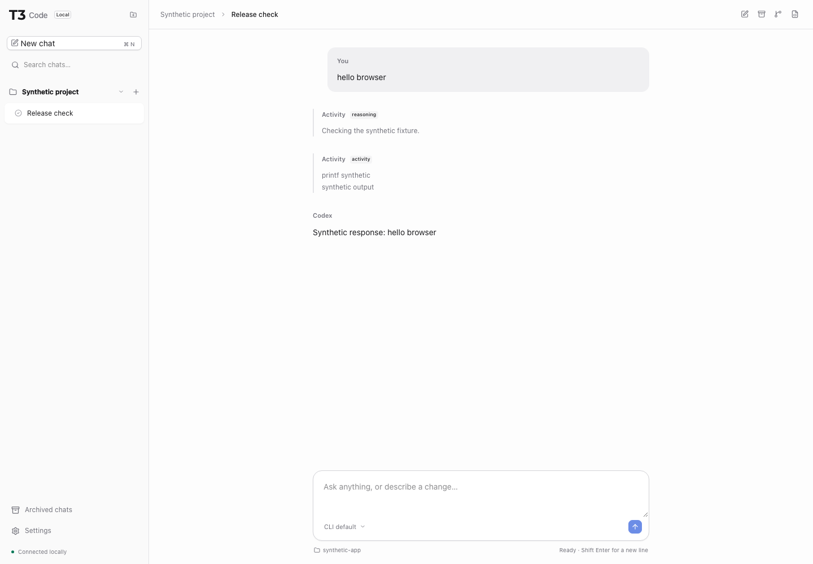

# T3 Code Local

A small local web UI for your existing Codex CLI. Projects, conversations and code stay in a familiar T3 interface, with local history and explicit workspace access.



## Features

- Multiple projects and authorized roots, with independent concurrent chats.
- Streaming, cancellation, native approvals and questions.
- Local history, resume, manual names and archives.
- Local code and diffs, explicit Git worktrees, and light/dark themes.
- Model and reasoning choices from the installed CLI's permitted capabilities.

The wrapper has no account, telemetry, update service, cloud sync, relay or background AI helpers. It never installs Codex or changes its authentication, endpoints, sandbox, approvals, skills or MCP configuration.

## Quick start

You need an already configured approved Codex CLI, Python 3.8+, Make, and access to a **local** Docker daemon with Docker Compose. Image builds download pinned build dependencies; application startup performs no installer or provider download.

```sh
make configure ROOT=/absolute/path/to/workspace CODEX=/absolute/path/to/codex
make up
make open
```

`make up` builds the image and starts the local service. `make open` authenticates the browser through a private local file, keeping its access token out of process arguments and logs. The default browser address is `http://127.0.0.1:3777`; open it through `make open` to authenticate.

With an already staged image, use `make up NO_BUILD=1` to start without building or pulling. Chat history lives in a Docker-managed named volume; `make down` preserves it. Private host configuration and the temporary launch capability stay under `.local-state`.

Codex continues to run **on the host**, with its existing environment and controls. The wrapper container has no network interface beyond its own loopback. A local host bridge carries browser traffic and Codex stdio through Docker exec; no credential directory, Docker socket, host network or privileged container is required. [How it works →](docs/GETTING-STARTED.md)

## Everyday commands

| Command | Purpose |
| --- | --- |
| `make up` / `make on` | Build as needed and start |
| `make down` / `make off` | Stop; keep configuration and chat history |
| `make restart` | Restart the local service |
| `make open` | Open the authenticated local UI |
| `make logs` | Follow operational logs |
| `make status` | Inspect the local service |
| `make health` | Check the wrapper and bridge; no model request |
| `make doctor` | Inspect prerequisites without changing settings |
| `make help` | Show available commands |

Prefer running without Docker? [Native Node setup](docs/GETTING-STARTED.md#native-node-setup) uses Node 24.18.0 and the same approved CLI.

The [release archive](docs/GETTING-STARTED.md#release-archive) also includes Make, Compose and a prebuilt Docker target, so its Docker workflow needs no Node installation on the host.

## Boundaries and status

Chats share files. A worktree isolates one repository; other roots and repositories remain shared. Workspace selection never broadens Codex's own policy.

The reduced app renders escaped text and code rather than raw HTML, remote images or embedded previews. The wrapper has zero runtime npm dependencies. Browser-global traffic and approved Codex/child traffic require separate deployment enforcement; local application tests are not a universal zero-egress guarantee.

Local automated and browser tests use synthetic data and a deterministic fake CLI. **Validate your installed Codex version and deployment platform before relying on the application.** Health checks do not establish authentication, model access or policy compliance. See [verification evidence](docs/VERIFICATION.md) and the [deployment smoke test](docs/DEPLOYMENT-SMOKE.md).

## Documentation

[Getting started](docs/GETTING-STARTED.md) · [Operations](docs/OPERATIONS.md) · [Development](docs/DEVELOPMENT.md) · [Security](docs/SECURITY.md) · [All documentation](docs/README.md)

## License and attribution

MIT. Based on [T3 Code](https://github.com/pingdotgg/t3code), pinned at `975b3dc56850d8a22dc90462219e53be95d8dcf7`. Upstream copyright and permission notices are preserved in [LICENSE](LICENSE). [Retained UI provenance](minimal/web/UPSTREAM.md) records copied and adapted components; built releases include third-party notices.
